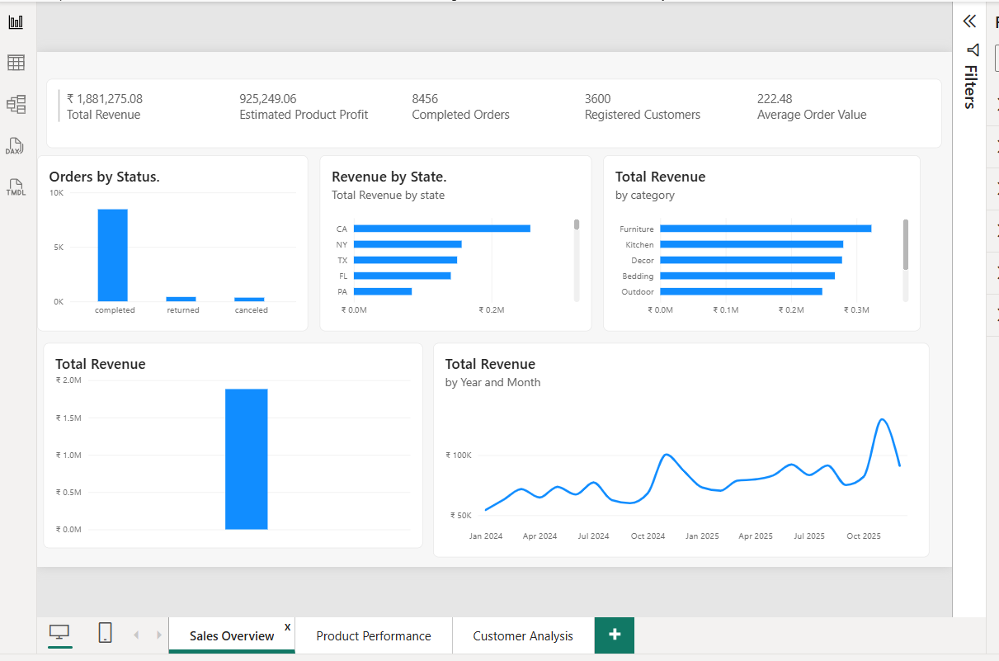
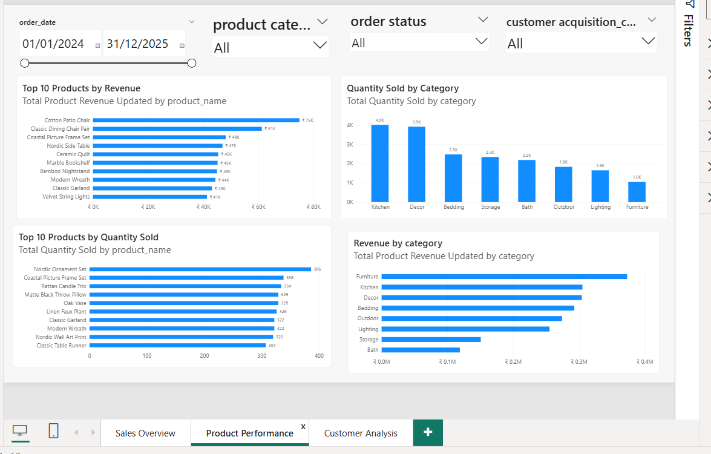
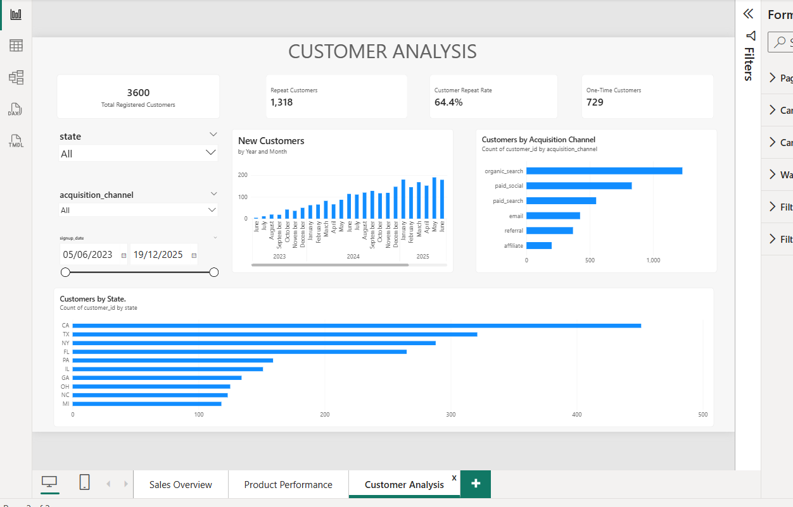

# E-commerce Data Analytics Project

**Tools:** Excel | SQL Server | Power BI

## Project Overview
This project focuses on analyzing e-commerce sales data to identify business trends, product performance, customer behavior, and revenue patterns.

## Tools & Technologies
- Microsoft Excel – Data exploration and data cleaning
- SQL Server – Data cleaning, querying, and data analysis
- Power BI – Data modeling, DAX calculations, and interactive dashboards

## Datasets
The project uses four datasets:
- customers.csv
- orders.csv
- order_items.csv
- products.csv

## Project Objectives
- Analyze overall sales and revenue performance.
- Identify top-performing products and categories.
- Analyze monthly revenue trends.
- Understand customer acquisition and retention.
- Identify repeat customers and one-time customers.
- Analyze sales by state and acquisition channel.

## Key Business Metrics
- Total Revenue: ₹1,881,275.08
- Estimated Product Profit: ₹925,249.06
- Completed Orders: 8,456
- Registered Customers: 3,600
- Repeat Customers: 1,318
- Customer Repeat Rate: 64.4%
- Average Order Value: ₹222.48

## Power BI Dashboard
The interactive dashboard contains three report pages:

1. **Sales Overview** – Revenue, profit, orders, and sales trends.
2. **Product Performance** – Top products and category performance.
3. **Customer Analysis** – Customer acquisition, retention, and repeat purchases.

## SQL Analysis
SQL Server was used to perform:
- Data cleaning and validation
- Joins and aggregations
- Monthly revenue analysis
- Customer retention analysis
- Product performance analysis
- Business KPI calculations

## Project Files
This repository includes:
- Original CSV datasets
- SQL analysis scripts
- Power BI dashboard (.pbix)
- Project documentation (.docx)

 ## Power BI Dashboard Screenshots

### 1. Sales Overview

### 2. Product Performance

### 3. Customer Analysis

## Conclusion
This project demonstrates practical data analytics skills, including data cleaning, SQL querying, data modeling, DAX calculations, and dashboard development.

## Author
**Adimulam Saikumar**

Aspiring Data Analyst
